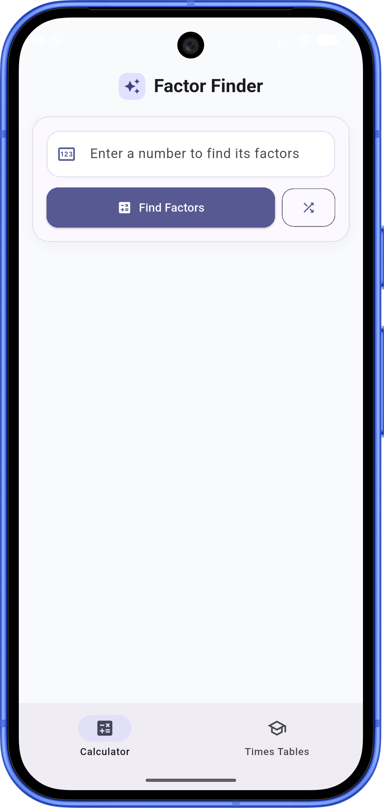
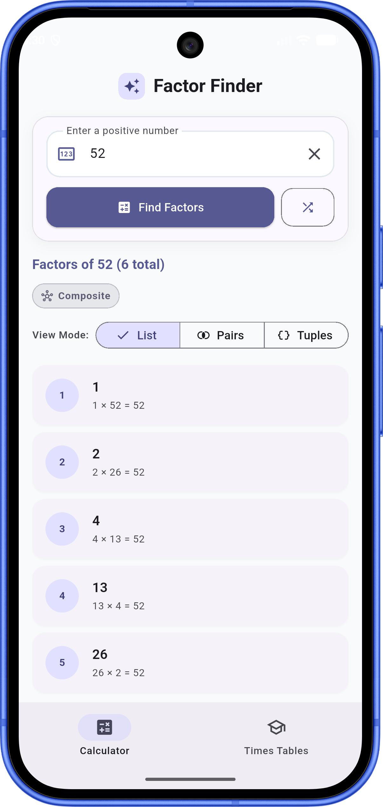
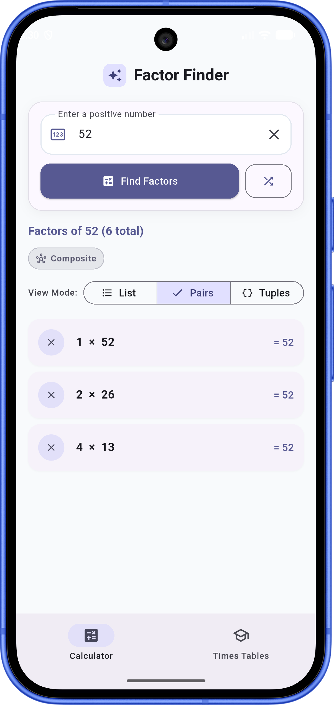
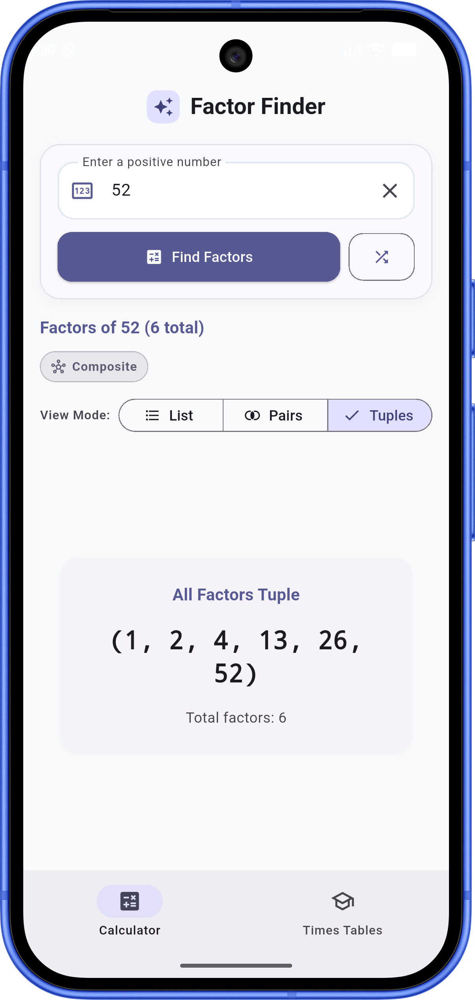
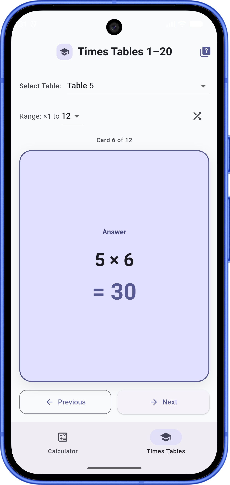
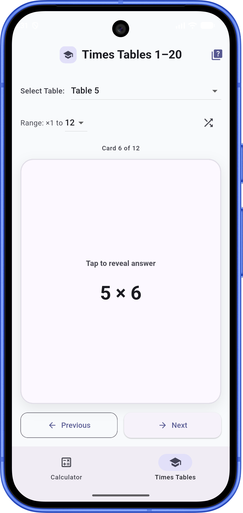

# Factor Finder & Times Tables (Factor App)

A modern, feature-rich Flutter application designed for math exploration, factor calculation, and times tables practice. Built with **Flutter**, **Material 3**, and **Provider** following Clean Architecture and MVVM design patterns.

---

## ✨ Features

### 1. 🧮 Factor Calculator & Finder
- **Optimal $O(\sqrt{N})$ Algorithm**: Efficiently computes all positive integer factors for any number in ascending order.
- **Mathematical Analysis**: 
  - **Prime Number Detection**: Instantly identifies whether a number is prime.
  - **Perfect Square Analysis**: Detects if the input is a perfect square.
  - **Sum of Factors**: Calculates the total sum of all factors.
  - **Factor Pairs**: Displays unique factor pairs $(f_1, f_2)$ where $f_1 \times f_2 = N$.
- **Quick Presets & Interactive UI**: Quick-select buttons and robust input validation with clear error states.

### 2. 📚 Times Tables & Flash Cards
- **Comprehensive Tables (1 to 20)**: Explore multiplication tables from 1 up to 20.
- **Adjustable Multipliers**: Customize multiplier ranges up to 20.
- **Interactive Flash Cards**: Study and test multiplication skills with flip cards and quiz capabilities.

### 3. 🎨 Material 3 Design & Dark Mode
- **Dynamic Theming**: Fully adaptive Material 3 UI supporting both Light and Dark modes.
- **Modern Navigation**: Seamless bottom navigation (`NavigationBar` + `IndexedStack`) between Calculator and Flash Cards.

---

## 📱 Screenshots

| Home Page | Factor List View | Factor Pairs |
| :---: | :---: | :---: |
|  |  |  |

| Tuple View | Solution Reveal | Times Tables & Flash Cards |
| :---: | :---: | :---: |
|  |  |  |

---

## 🏗️ Architecture & Tech Stack

- **Framework**: [Flutter](https://flutter.dev) (Dart SDK `^3.7.2`)
- **State Management**: [Provider](https://pub.dev/packages/provider) (`ChangeNotifierProvider`, `MultiProvider`)
- **Architecture**: MVVM (Model-View-ViewModel) with decoupled Business Logic Services:
  - `FactorCalculatorService`: Pure Dart calculation logic.
  - `FlashCardService`: Table generation logic.
  - `FactorViewModel` / `FlashCardViewModel`: ViewModels managing reactive state (`ChangeNotifier`).
- **Design System**: Material 3 with custom color schemes and typography.
- **Multiplatform Support**: Android, iOS, Web, macOS, Linux, and Windows.

---

## 📁 Project Structure

```text
lib/
├── models/
│   ├── factor_result.dart      # Immutable model for factor calculations & properties
│   └── flash_card.dart         # Immutable model for times table flash cards
├── services/
│   ├── factor_calculator_service.dart  # O(√N) factor calculation algorithm
│   └── flash_card_service.dart         # Times table generator (1–20)
├── viewmodels/
│   ├── factor_viewmodel.dart   # Reactive state management for Factor Finder
│   └── flash_card_viewmodel.dart # Reactive state management for Flash Cards
├── views/
│   ├── widgets/
│   │   ├── empty_factor_state.dart     # Empty/initial state widget
│   │   ├── factor_input_section.dart   # Input form and quick presets
│   │   └── factor_list_section.dart    # Factor results, pairs, and properties display
│   ├── factor_screen.dart              # Main Factor Finder screen
│   ├── flash_card_screen.dart          # Flash cards & times tables screen
│   └── main_navigation_screen.dart     # Bottom navigation container
└── main.dart                           # App entry point, Providers, & Light/Dark themes
```

---

## 🚀 Getting Started

### Prerequisites
- [Flutter SDK](https://docs.flutter.dev/get-started/install) (`^3.7.2` or higher)
- Dart SDK (`^3.7.2`)
- Android Studio / VS Code with Flutter & Dart extensions
- Target device emulator/simulator or physical device (Android, iOS, Web, Desktop)

### Installation & Execution

1. **Clone the repository**:
   ```bash
   git clone https://github.com/your-username/factor-app.git
   cd Factor_App
   ```

2. **Install dependencies**:
   ```bash
   flutter pub get
   ```

3. **Run the application**:
   ```bash
   flutter run
   ```

4. **Run tests**:
   ```bash
   flutter test
   ```

---

## 📄 License

This project is open-source and available under the [MIT License](LICENSE).
